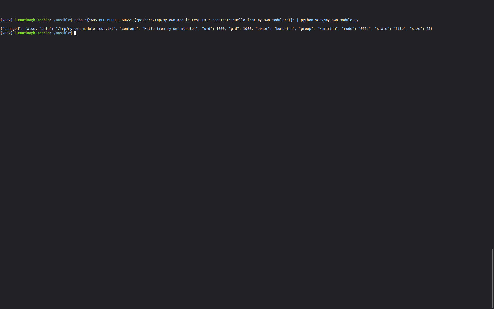
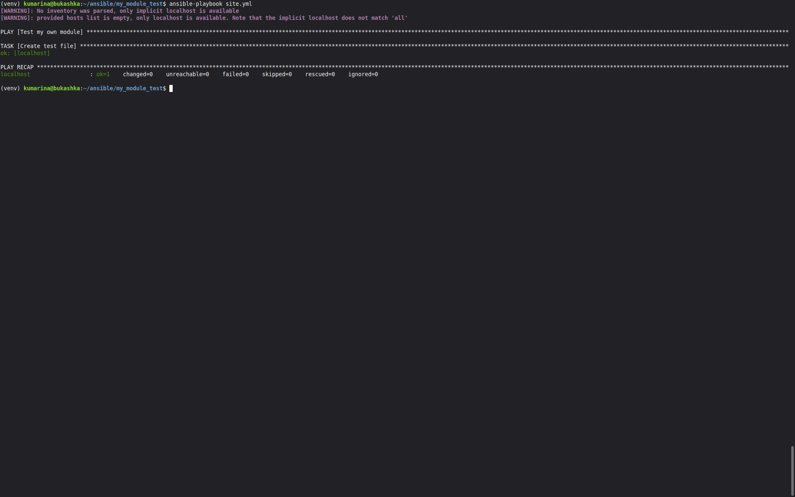
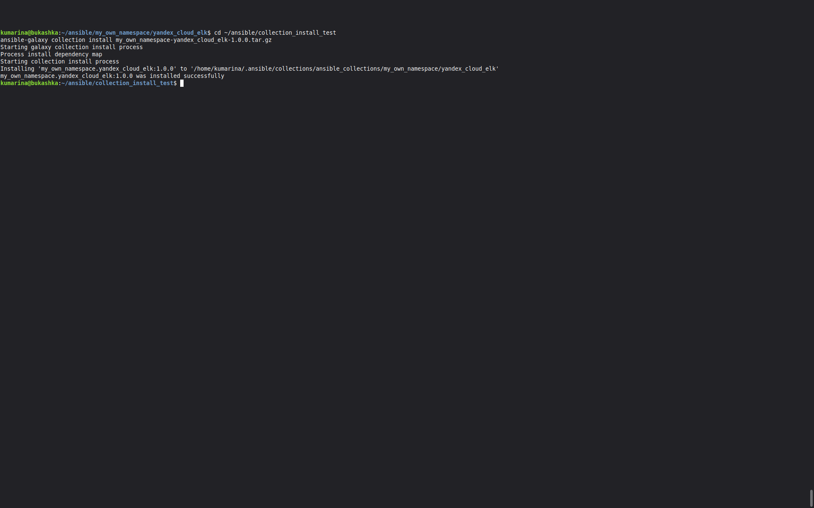
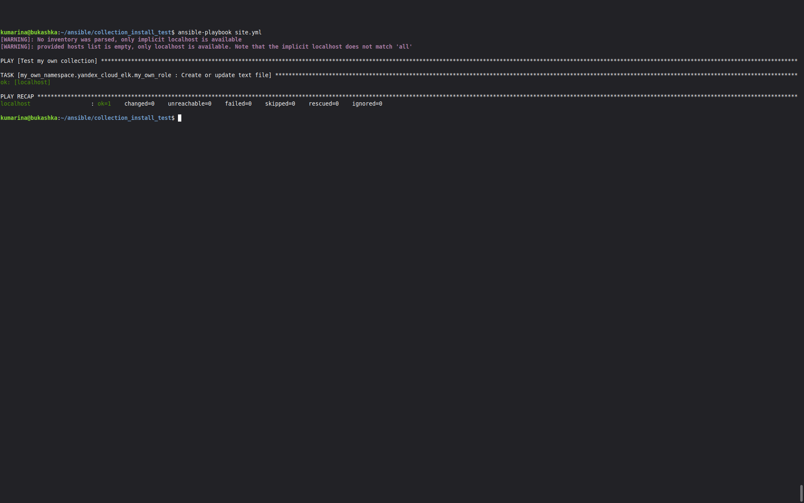

# my_own_namespace.yandex_cloud_elk

Ansible Collection с собственным модулем для создания и обновления текстовых файлов на удалённых хостах.

## Возможности

Коллекция содержит:

- собственный Ansible-модуль `my_own_module`;
- роль `my_own_role`, использующую этот модуль;
- параметры роли, определённые через `defaults`.

Модуль поддерживает идемпотентное выполнение: если файл уже существует и его содержимое соответствует заданному, изменения не выполняются.

## Требования

- Ansible Core 2.19+
- Python 3.12+

## Установка

Коллекцию можно установить из собранного архива:

    ansible-galaxy collection install my_own_namespace-yandex_cloud_elk-1.0.0.tar.gz

## Модуль my_own_module

Модуль предназначен для создания или обновления текстового файла на целевом хосте.

### Параметры

| Параметр | Тип | Обязательный | Описание |
|---|---|---|---|
| `path` | `str` | Да | Путь к файлу на целевом хосте |
| `content` | `str` | Да | Содержимое файла |

### Пример использования

    ---
    - name: Create a text file
      hosts: localhost
      connection: local
      gather_facts: false

      tasks:
        - name: Create test file
          my_own_namespace.yandex_cloud_elk.my_own_module:
            path: /tmp/example.txt
            content: "Hello from my own module!"

При первом запуске, если файла нет, модуль создаст его:

    changed: [localhost]

При повторном запуске с теми же параметрами файл не изменяется:

    ok: [localhost]

Таким образом, модуль является идемпотентным.

## Роль my_own_role

Роль использует модуль `my_own_module` и предоставляет значения параметров через `defaults/main.yml`.

### Переменные роли

По умолчанию используются следующие значения:

    path: /tmp/my_own_module_playbook.txt
    content: "Hello from Ansible custom module!"

Обе переменные можно переопределить при использовании роли.

### Пример использования роли

    ---
    - name: Use my own role
      hosts: localhost
      connection: local
      gather_facts: false

      roles:
        - my_own_namespace.yandex_cloud_elk.my_own_role

### Переопределение параметров

Например:

    ---
    - name: Create custom file
      hosts: localhost
      connection: local
      gather_facts: false

      vars:
        path: /tmp/custom.txt
        content: "Custom content"

      roles:
        - my_own_namespace.yandex_cloud_elk.my_own_role

## Структура коллекции

    yandex_cloud_elk/
    ├── galaxy.yml
    ├── README.md
    ├── meta/
    │   └── runtime.yml
    ├── plugins/
    │   ├── README.md
    │   └── modules/
    │       └── my_own_module.py
    └── my_own_role/
        ├── defaults/
        │   └── main.yml
        ├── handlers/
        │   └── main.yml
        ├── meta/
        │   └── main.yml
        ├── tasks/
        │   └── main.yml
        ├── tests/
        │   ├── inventory
        │   └── test.yml
        ├── vars/
        │   └── main.yml
        └── README.md

## Сборка коллекции

Для создания архива коллекции необходимо перейти в корневой каталог коллекции:

    cd my_own_namespace/yandex_cloud_elk

Затем выполнить:

    ansible-galaxy collection build

В результате будет создан архив:

    my_own_namespace-yandex_cloud_elk-1.0.0.tar.gz

## Установка локальной сборки

Установить собранную коллекцию можно командой:

    ansible-galaxy collection install my_own_namespace-yandex_cloud_elk-1.0.0.tar.gz

После установки коллекцию можно использовать в playbook независимо от исходного каталога проекта.

## Версия

Текущая версия коллекции: `1.0.0`

## Репозиторий

Исходный код коллекции находится на GitHub:

https://github.com/kumarina-max/my_own_collection

## Лицензия

MIT

## Скриншоты выполнения пунктов 4, 6, 15 и 16.

